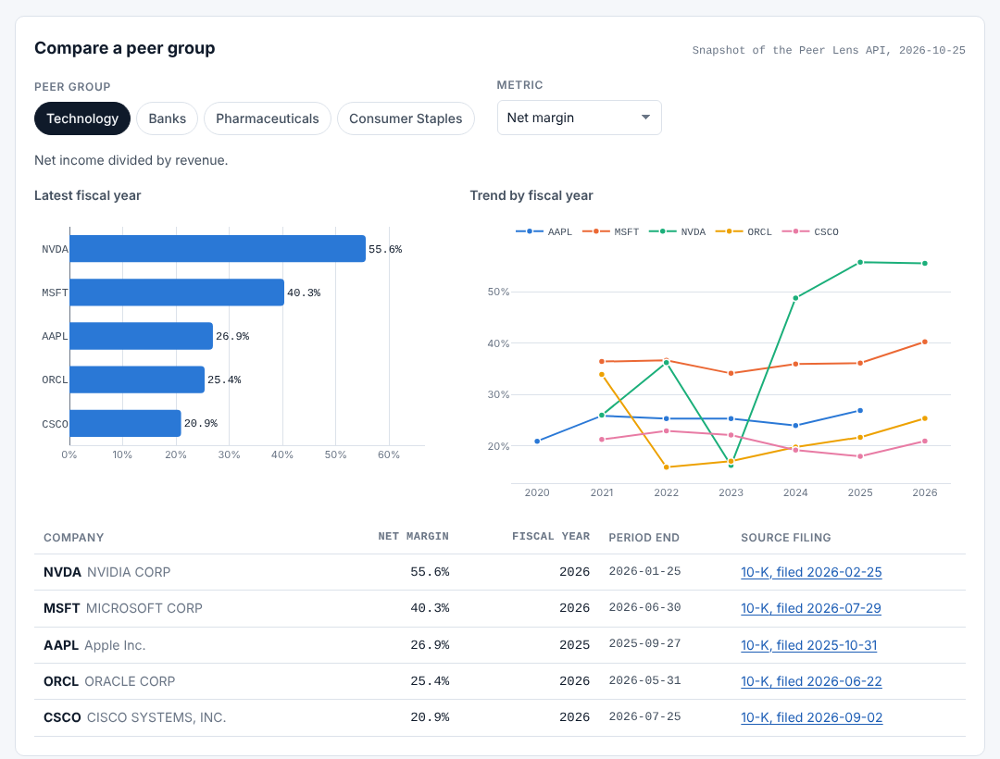
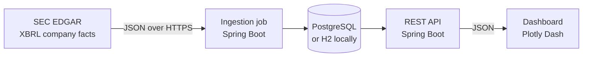

# Peer Lens

[](https://github.com/RJ318/peer-lens/actions/workflows/ci.yml)

**Live demo: [rj318.github.io/peer-lens](https://rj318.github.io/peer-lens)**

Peer Lens loads annual fundamentals for four sector peer groups straight from SEC EDGAR filings,
stores them in SQL with a link back to the source filing for every number, and serves side-by-side
comparisons through a Java REST API and a Plotly Dash dashboard.

It answers the questions a research analyst asks first: within a peer group, who has the highest
margin, who is growing fastest, and whose earnings are backed by cash.



Built by Ravi Jethva with Claude as an AI coding partner.

## What it covers

| Peer group | Companies |
|---|---|
| Technology | AAPL, MSFT, NVDA, ORCL, CSCO |
| Banks | JPM, BAC, WFC, C, GS |
| Pharmaceuticals | JNJ, PFE, MRK, ABBV, LLY |
| Consumer Staples | PG, KO, PEP, CL, KMB |

Metrics: revenue, net income, operating cash flow, net margin, revenue growth, and cash conversion,
for up to six fiscal years per company. The watchlist is configuration, not code.

## Architecture



| Part | Stack |
|---|---|
| `api/` | Java 21, Spring Boot, Spring JDBC (`JdbcClient`), Flyway, Apache HttpClient, JUnit 5 |
| `dashboard/` | Python, Plotly Dash, pandas, pytest, ruff |
| Data | PostgreSQL 16 in Docker; H2 in PostgreSQL mode for local runs and tests |
| Delivery | Docker Compose, GitHub Actions CI |

## Run it

You need Docker. The SEC requires every client to identify itself, so set your name and email first.

```bash
cp .env.example .env    # set SEC_USER_AGENT="Your Name you@example.com"
docker compose up --build
```

Open the dashboard at http://localhost:8050. The API is at http://localhost:8080. On first start the
API loads all 20 companies from SEC EDGAR, which usually takes between a few seconds and a couple of
minutes depending on how quickly the SEC serves the files.

To run without Docker, see [docs/RUNBOOK.md](docs/RUNBOOK.md).

## Design decisions

**One clean value per fiscal year.** Raw XBRL data is repetitive and inconsistent. Every 10-K repeats
the prior two years as comparatives, amendments and restatements re-report periods, and annual
reports also carry quarterly figures. The extractor keeps only roughly one-year periods (350 to 380
days, which covers 52- and 53-week fiscal years) from 10-K and 10-K/A filings, and for each period
the most recently filed value wins, whichever concept it was tagged with, so restatements replace the
original figures. Every metric shares one window of the six most recent fiscal years, so a gap in one
metric can never misalign the years of another.

**Growth is measured within one filing.** A restatement recasts only the years in the restating
filing, so comparing this year's restated revenue with last year's original figure can turn a gain
into a loss. Revenue growth is therefore taken from the most recent single filing that reports both
years, and the API links to that filing.

**Concepts differ by company, by year, and by industry.** Companies switched revenue tags when the
ASC 606 standard took effect, and some tag a component (product revenue) and the total in the same
filing. Concept priority decides only between values from the same filing, with `Revenues` first so
the total wins. Banks are different again: their headline figure is net revenue, and the standard
"revenue from contracts with customers" tag covers only a bank's fee income, so the banks sector has
its own concept list.

**Every number is traceable.** Each stored value keeps its XBRL concept, form type, filing date, and
accession number, and the API returns a link to the filing on sec.gov.

**Missing is not zero.** Ratios are `null` when the inputs do not support them: no growth unless one
filing reports both years, and no cash conversion when net income is zero or negative.

**A polite, resilient client.** Requests carry a declared User-Agent, are spaced well under the SEC's
10-per-second limit, accept gzip, and retry 429, 5xx, and network errors with exponential backoff
that honors `Retry-After`. A 403 fails fast with a message that points at the User-Agent setting.

**Failures stay contained and visible.** One company failing never stops the others. Each company is
replaced inside its own transaction, so a failed load keeps the previous data. A company that loads
but is missing a metric is marked `INCOMPLETE` rather than counted as a success. Every run and every
company result is recorded in the database and readable through the admin API.

**Secure by default.** Admin endpoints are off unless a token is configured, and the token is checked
in constant time. Errors are RFC 9457 problem responses with no stack traces. Containers run as
non-root users. Secrets live in a git-ignored `.env` file.

## Tests

- `api/`: unit tests for the extraction rules and metric math, client tests against a mock SEC server
  (User-Agent, retries, `Retry-After`, 403 and 404 handling), and integration tests that run the
  whole service against the mock SEC and an in-memory database.
- `dashboard/`: tests for formatting, data shaping, the API client, and the page callbacks.

Test fixtures use invented companies, so no test depends on the live SEC.

Against live data, `scripts/verify_against_sec.py` checks the running API with different mechanisms
from the service itself: it compares each stored figure with the value the SEC selected for that
period, flags any year where another revenue concept reports a larger total, and recomputes every
growth rate from the 10-K covering the following year.

## Demo site

`site/` is a static page published to GitHub Pages by `.github/workflows/pages.yml`. It charts a
snapshot of the API's output, exported with `scripts/export_site_data.py`, so visitors can use it
without running anything.

## Documentation

- [API reference](docs/API.md)
- [Runbook](docs/RUNBOOK.md): configuration, refreshing data, and troubleshooting
- [Data notes](docs/DATA-NOTES.md): what the first live load revealed about SEC data, and how each
  finding changed the code

## Limitations

- A restatement only recasts the years included in the restating filing, so revenue levels on either
  side of that boundary can be on different accounting bases (Johnson & Johnson's 2020 figure includes
  the consumer health business it later spun off; 2021 onward does not). Growth rates are not affected.
  See [Data notes](docs/DATA-NOTES.md).
- `fiscalYear` is the year of the period end after stepping back seven days, so a 52- or 53-week year
  ending in early January takes the prior year's label. That matches every company on the watchlist,
  but retailers that label a year ending in late January or February by the prior year would need a
  different rule. `periodEnd` is always returned.
- The read endpoints have no authentication, which suits a local research tool but not a shared
  deployment.

## Data source and disclaimer

Data comes from the SEC's public EDGAR APIs. This is a personal project for research and engineering
practice. It is not investment advice and is not affiliated with any company it displays.

## License

MIT
